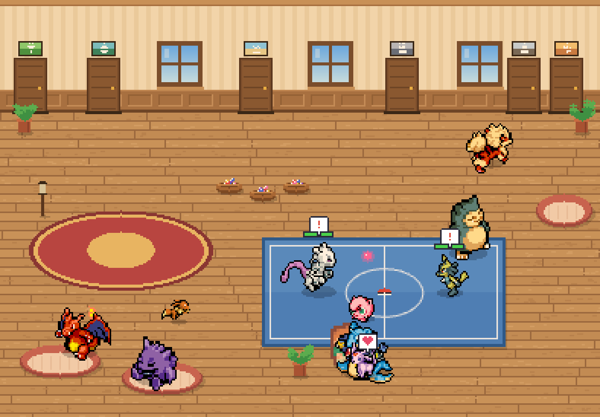
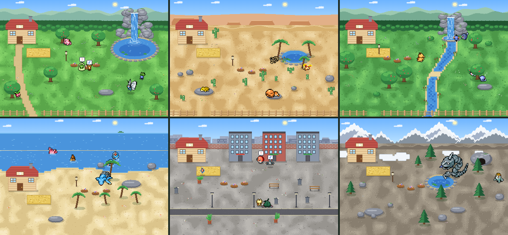
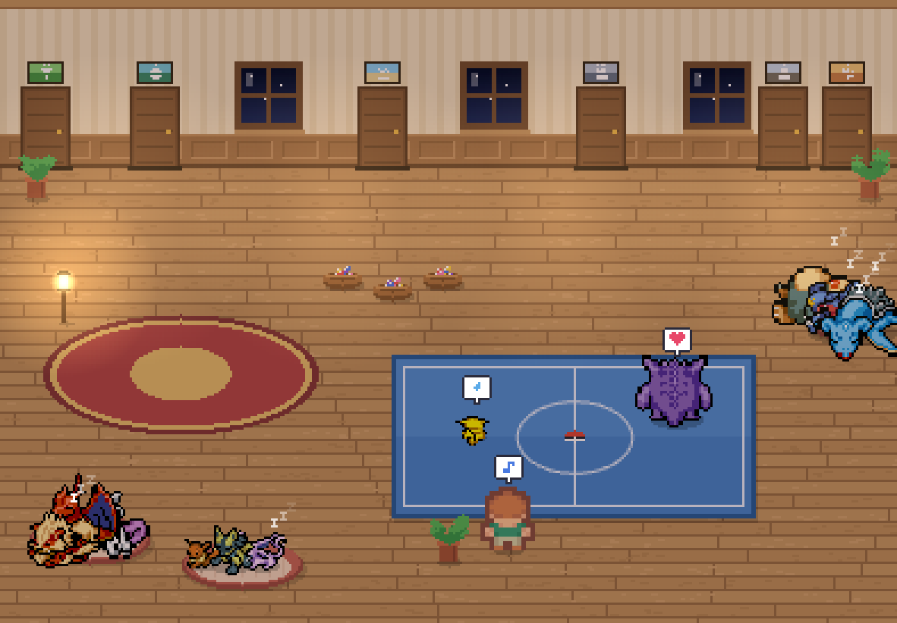

# Pixel Daycare

An always-on pixel daycare for your iPad (or any browser). Bring in the party from your emulator save, and watch them roam a little world on their own: a big hub house with an arena and your trainer, plus a meadow, desert, river, beach, city and mountains. Build it however you like, and visit friends' houses with a link.

**Try it in your browser:** https://funnierthanever.github.io/pixel-daycare/



> **Fan project.** Pixel Daycare is a free, non-commercial fan project. It is not affiliated with, endorsed by or sponsored by Nintendo, The Pokémon Company, Creatures Inc. or GAME FREAK inc. Pokémon and Pokémon character names are trademarks of Nintendo. This repository contains no Nintendo assets and no ROMs: Pokémon sprites are fetched at runtime from the community [PMD SpriteCollab](https://github.com/PMDCollab/SpriteCollab) project, and the trainer sprites are CC0 by Kenney. It will never be sold.

## Run it

From this folder on the Mac:

```bash
python3 serve.py
```

On the iPad (same Wi-Fi), open `http://<your-mac-name>.local:8642` in Safari, then Share → Add to Home Screen.

To have it start by itself every time you log in, run `./autostart.sh` once (`./autostart.sh remove` undoes it).

## As an iPad app (no browser, no Mac server)

The `ios/` folder is a small iPad app that bundles the daycare and runs it full screen. It keeps the screen awake by itself and stores sprites on the iPad, so it works offline once each Pokémon has loaded. It doesn't need the Mac server.

Installing it on your iPad (one time):

1. Plug the iPad into the Mac and open the project: `open ios/PixelDaycare.xcodeproj`
2. In Xcode: **Settings → Accounts → +**, sign in with your Apple ID (a free one works).
3. Click **PixelDaycare** in the left sidebar → **Signing & Capabilities** → set **Team** to your Personal Team. If Xcode says the bundle identifier is taken, change it to something like `com.yourname.daycare`.
4. Pick your iPad from the device menu at the top and press **Run** (⌘R).
5. On the iPad, if asked: turn on **Settings → Privacy & Security → Developer Mode** (it restarts), then trust yourself under **Settings → General → VPN & Device Management**.

With a free Apple ID, Apple lets self-installed apps run for 7 days. After that, plug in and press Run again; your residents and your build are kept. A paid Apple Developer account ($99/year) makes it last a year.

When the daycare code changes, press Run again; the build copies the latest files into the app. If you change `ios/project.yml`, regenerate the project with `cd ios && xcodegen generate`.

## Bringing your Pokémon in

The first time you open the daycare, a welcome card offers **Choose your save file…**. You can also drop a save anywhere on the page, or use Settings (gear, bottom right) → **Choose save file…** later. On the iPad, pick the battery save your emulator synced to iCloud/Files.

The picker shows your party and every PC box. The first 100 are picked for you (party first, then box by box). Tap Pokémon to skip or add them, or use a box's All/None button. Then choose whether they **replace** who's living there now or are **added** to them. The first dozen arrive in the hub, and the rest head straight for the area they like best.

Your save is read in the browser on your own device. It is never uploaded anywhere.

| Gen | Games | Files |
| --- | --- | --- |
| 1–2 | Red/Blue/Yellow, Gold/Silver/Crystal | `.sav` / `.srm` (32 KB) |
| 3 | Ruby/Sapphire/Emerald, FireRed/LeafGreen | `.sav` / `.srm` (128 KB) |
| 4–5 | Diamond/Pearl/Platinum, HGSS, B/W, B2/W2 | `.sav` / `.dsv` (512 KB) |

ROM hacks that keep the original save layout work. Hacks with expanded species lists (CFRU-based ones like Radical Red) may show unknown species; add those residents by hand.

## The hub and the areas

The daycare is one connected world. In the middle is the **hub**, a big house with a door to every area: **Meadow, Desert, River, Beach, City and Mountain**. Each outdoor area's house is its way into the hub, so Pokémon travel area → hub → area, and you can watch them cross the hub on the way.



- **Roaming:** every Pokémon decides for itself when to move and where to go, based on what it is. Types set the taste (water types like the river and beach, poison/steel/electric like the city, rock/ground/ice like the mountains, fire like the desert), and some species have famous homes (Trubbish and Grimer → City, Sandslash and Geodude → Mountain, Cacnea and Trapinch → Desert, Magikarp → River, Tentacool → Beach). They stay longer where they like it and drop by the hub now and then. Night Pokémon roam at night; sleeping Pokémon stay put.
- **The trainer:** you, walking around the hub. You stroll between the rug, the food bowls and your Pokémon, stop to greet Pokémon that come over, walk up to give one some attention, and cheer from the side of the arena during battles. Pick your look (six characters) in Settings → Your trainer. Tap the trainer to see who's around and who's the arena champ.
- **The arena:** in the hub, Pokémon challenge each other to friendly battles. They face off, take turns attacking with a move that fits their type (embers, bubbles, lightning, leaves, energy orbs, rocks, tackles), with HP bars, until one is worn out. Others gather round to watch. Wins and losses show on each Pokémon's card.
- **Getting around:** tap a door in the hub to go to that area, or tap an area's house to go back into the hub. You can also flip areas with ◀ ▶ or swipe across the field. **▦** opens the PC, which shows where everyone is right now (and who's on the way). Drag a Pokémon onto another area to send it there, tap a picture to go there, and rename, change, add or delete areas. The hub can't be deleted; deleting an area sends its Pokémon back to the hub.
- Only the area on screen is drawn and fully simulated; the rest of the world keeps going in the background.

The day follows your real clock. At night the lamps come on, the windows fill with stars, and most of the house goes to sleep (Gengar doesn't):



## Visiting friends

Settings → **Visit friends** → type your trainer name → **Share my house**. You get a link (and the share sheet on iPad). Anyone who opens it sees your house in their browser as it is right now: your areas and builds, your Pokémon roaming, battling and dropping by your trainer, with their own trainer walking around as a guest.

- In the iPad app, **Visit a friend…** takes a pasted link or code.
- Visiting never changes anything: nothing is saved, build mode is off, and **Go home** takes you back.
- A link is a snapshot. Share a new one after you've changed things.
- The whole house travels inside the link itself (compressed, usually well under 2 KB), so there's no server and no account. Codes from other people are checked and cleaned before use.

## Pokémon sizes

Each Pokémon is drawn at a size based on its Pokédex height, so Snorlax towers over Pikachu and Onix dwarfs both. Real heights range from 0.1 m to 14.5 m, so the scale is compressed to fit the screen (roughly 16 px for Pikachu, 35 px for Snorlax, 60 px for Onix). Every individual also gets its own size within about ±10%, kept for good.

## Build your own daycare

Tap 🔨 (bottom right) to enter build mode. It's always daylight while you build.

- **Build:** pick something from the toolbar and tap the field to place it: trees, pines, palms, cacti, bushes, reeds, flowers, seashells, boulders, sunny rocks, caves, ponds, waterfalls, berry bowls, lanterns, hay beds, pet beds, houses, fences, an arena, the trainer, rugs, plants, windows, buildings, street lamps, benches, trash cans and litter. Fences, flowers, reeds, shells and litter are drawn by dragging. Hub doors can be moved but not removed.
- **Paint:** drag to paint path, sand, shallow water, snow or road (the first swatch paints the area's own ground back over them). The brush button switches between small, medium and large.
- **Move:** drag anything to move it, Pokémon included. Tap something to make it bigger or smaller, shuffle its look, or remove it.
- **Erase:** tap or drag over things to remove them.
- **Undo / Reset / Clear** are in the top right corner.
- **Export / Import:** save your world as a `.json` file (on iPad the share sheet offers Save to Files or AirDrop) and load it on another device. A world from a different screen size is stretched to fit.

Your world is saved on the device automatically. The Pokémon use whatever you build: they sleep on hay beds, eat from every bowl, nap under trees, swim in ponds and painted water, sunbathe on sunny rocks and gather at lanterns at night. If something is missing (no pond, say), they find something else to do.

## How the routines work

- **Body clock:** Ghost/Dark types and night species (Hoothoot, Zubat, Clefairy, Volbeat…) wake around 18:00–19:30 and sleep at dawn. Everyone else wakes 5:30–8:00 depending on nature (Jolly/Hasty early, Relaxed/Lax late).
- **Meals:** bowls refill at 6:00, 12:00, 18:00 and midnight. Hunger builds over the day, so refills cause a rush.
- **Favourite spots by type:** Water types swim, Grass/Bug lounge under trees, Fire/Rock/Ground sunbathe on the rock, Ghost/Psychic watch the waterfall.
- **Personality from nature:** social natures start games of tag or sit together, shy ones get flustered, sleepy ones nap after lunch, gluttons eat more.

Pokémon sprites are loaded at runtime from the community PMD SpriteCollab project. None are stored in this folder.

Trainer sprites: `assets/trainer.png` is the character strip from **RPG Urban Pack by Kenney** (www.kenney.nl), released under CC0 (public domain). The pack's license is in `assets/KENNEY-LICENSE.txt`. Credit isn't required, but it's here anyway.

## Files

- `js/saves.js`: save parsers for the party and PC boxes (Gen 1–5)
- `js/ingest.js`: the welcome card, drag-and-drop and the save picker
- `js/growth.js`: experience tables (box Pokémon store experience, not a level)
- `js/world.js`: terrain, walkability, spots, sky and lighting
- `js/objects.js`: everything you can build and how it's drawn
- `js/pc.js`: the PC screen (areas, drag between areas)
- `js/roam.js`: roaming between areas and area preferences
- `js/battle.js`: arena battles and move effects
- `js/trainer.js`: the trainer walking around the hub
- `assets/`: the trainer sprite sheet and its license
- `docs/`: screenshots for this README
- `js/heights.js`: Pokédex heights (generated from PokeAPI data)
- `js/editor.js`: build mode
- `js/art.js`: palette and pixel helpers
- `js/mons.js`: behaviour and emotes
- `js/main.js`: loop, roster, settings panel
- `js/data.js`: generated species names, types and index tables
- `ios/`: the iPad app (`project.yml` for XcodeGen, Swift sources, app icon)
